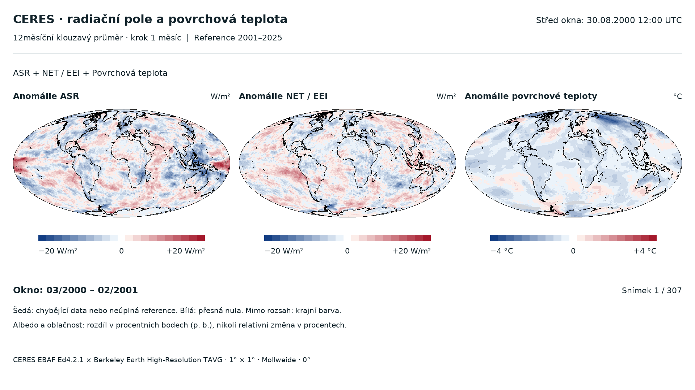

# CERES — interaktivní tři mapy a export MP4

Atlas má tři přepínatelné oblasti: [Celý svět](https://nabiknab-eng.github.io/ceres/), [Evropa](https://nabiknab-eng.github.io/ceres/evropa/) a [Střední Evropa](https://nabiknab-eng.github.io/ceres/stredni-evropa/). Při přepnutí zůstává zvolený snímek, časové rozlišení, veličiny i ruční nastavení škál. Automatické škály se přepočítají pro nový výřez. Místní export MP4 pro regionální pohledy je popsaný v návodech pro [Evropu](evropa/) a [Střední Evropu](stredni-evropa/).

**[Otevřít web CERES](https://nabiknab-eng.github.io/ceres/)** · **[Původní nezměněný web ASR](https://nabiknab-eng.github.io/ceres-asr-temperature-atlas/)**

- [Offline HTML, všechna vizualizační data a exportní nástroj (ZIP)](https://github.com/nabiknab-eng/ceres/archive/refs/tags/v1.0.0.zip)
- [Hotové MP4 celého období, H.264 / 1920 × 1080](https://github.com/nabiknab-eng/ceres/releases/download/v1.0.0/ceres_ASR_NET_T_2000-2026_6fps.mp4)
- [Plné výsledky všech šesti veličin ve float64 (NetCDF)](https://github.com/nabiknab-eng/ceres/releases/download/v1.0.0/ceres_anomalies.nc)
- [Přesná časová okna všech snímků videa](https://github.com/nabiknab-eng/ceres/releases/download/v1.0.0/ceres_ASR_NET_T_2000-2026_6fps.frames.json)
- [Vydání v1.0.0](https://github.com/nabiknab-eng/ceres/releases/tag/v1.0.0)

Rozbalte ZIP, otevřete `index.html` a ponechte celou složku pohromadě. Prohlížení funguje offline. Pro MP4 vyberte veličiny, tři barevné škály a interval v HTML, uložte exportní JSON a spusťte místní `export_mp4.py` nebo `Export_MP4.command`. První instalace Python závislostí může vyžadovat internet; další exporty jsou místní.



## Reprodukce úplných výpočtů

Původní měsíční vstupy jsou totožné s již veřejně archivovanými soubory ASR. Nemusí se znovu stahovat z NASA ani Berkeley Earth, pokud už je máte místně.

1. Rozbalte [úplný původní archiv ASR v1.0.0](https://github.com/nabiknab-eng/ceres-asr-temperature-atlas/releases/download/v1.0.0/ceres_atlas_uplny.zip). Zkopírujte `ceres_atlas/raw` do `asr/original/raw` a `ceres_atlas/data` do `asr/original/data`.
2. Do `asr/data/rolling_anomalies.nc` doplňte [původní klouzavé výsledky ASR v2.0.0](https://github.com/nabiknab-eng/ceres-asr-temperature-atlas/releases/download/v2.0.0/rolling_anomalies.nc), proti nimž se ověřuje neměnnost původních hodnot.
3. Nainstalujte `requirements.txt` a spusťte `build_ceres.py`. Vznikne `data/ceres_anomalies.nc`, lokální datové bloky a výpočetní protokol. Vstupní SHA-256 jsou v manifestu.

Pro samotné prohlížení nebo nový export MP4 postačí obsah tohoto repozitáře; původní měsíční vstupy nejsou potřeba.

## Zachování ASR a kontroly

Tento repozitář i web mají vlastní adresu. Repozitář `ceres-asr-temperature-atlas` ani jeho obsah se publikováním CERES nemění. Úplná místní kopie ASR byla před publikováním ověřena proti 194 kontrolním součtům. Zdejší `asr/` obsahuje pouze podpůrné skripty, nikoli druhou kopii webu a velkých dat.

Výpočetní, prohlížečové a mediální protokoly zaznamenávají již provedené kontroly: všech 307 měsíčních oken, neměnnost reference, 2 022 shodných mapových rastrů JavaScript/Python, offline Safari a všech 307 dekódovaných snímků MP4. `validate_ceres.py` při kompletní místní kopii kontroluje i zachování ASR; při práci ze samostatného klonu použijte `--skip-asr-preservation`.

## Ovládání a export

# CERES — tři synchronizované mapy

Verze s pěti nezávisle volitelnými veličinami u první a druhé mapy: **ASR, OLR, NET / EEI, planetární albedo a Cloud Fraction**. Třetí mapa zobrazuje povrchovou teplotu Berkeley Earth. Výchozí sestava je **ASR – NET – teplota**, s mezemi **±20 W/m², ±20 W/m² a ±4 °C**.

## Otevření a ovládání

Otevřete `index.html` v aktuálním Safari, Chrome nebo Firefoxu. Celou složku ponechte pohromadě. Prohlížení nevyžaduje server ani internet; nevyužívá CDN, externí fonty ani síťová volání. Odkazy na dokumentaci NASA jsou dobrovolné.

- Pod mapami vyberte veličiny první a druhé mapy. Lze vybrat i tutéž veličinu dvakrát s rozdílnou citlivostí.
- Každá ze tří map má vlastní táhlo i automatickou škálu. Ruční nastavení se pamatuje pro každou veličinu a panel během otevřené relace.
- Přepínejte roční mapy 2001–2025, pětiletí 2001–2005 až 2021–2025 a 12měsíční animaci s měsíčním krokem.
- Přehrávejte, pozastavujte, krokujte nebo přejděte přímo na libovolné okno časovým posuvníkem.
- Rozbalovací sekce hned pod nadpisem vysvětluje data, časová okna, všechny dostupné veličiny, znaménka a jednotky.

Všechny mapy používají totožné okno a pevnou místní referenci 2001–2025. Společné vstupy pokrývají **03/2000–08/2026**, tedy **307 úplných klouzavých oken**. První je 03/2000–02/2001 (střed 30.08.2000 12:00 UTC), poslední 09/2025–08/2026 (střed 02.03.2026 12:00 UTC).

| Veličina | Ruční symetrická škála | Krok |
| --- | --- | --- |
| ASR, OLR, NET | ±5 až ±40 W/m² | 1 W/m² |
| Planetární albedo | ±0,5 až ±10 procentních bodů | 0,1 p. b. |
| Cloud Fraction | ±1 až ±30 procentních bodů | 0,5 p. b. |
| Teplota | ±1 až ±7 °C | 0,2 °C |

Automatická škála se určí z maxima absolutní anomálie celé zvolené časové řady dané veličiny, zaokrouhlí nahoru na krok táhla a omezí jeho povoleným rozsahem. Během animace se nemění. Překročení rozsahu ovlivní pouze barvu, nikoli hodnoty. Modrá = záporná anomálie, červená = kladná, bílá = přesná nula, šedá = chybějící hodnota.

## Export MP4

1. Vyberte obě veličiny, všechny tři barevné škály, úsek od–do a rychlost videa.
2. Klikněte na **Export MP4 — stáhnout nastavení**. Uloží se `ceres-export.json` s konkrétními aktuálními mezemi i výběrem veličin.
3. Na Macu otevřete `Export_MP4.command`, přetáhněte uložený JSON do terminálu a potvrďte Enterem. Bez JSON se použijí výchozí nastavení.

Alternativně:

```sh
python3 -m venv .venv
.venv/bin/python -m pip install -r requirements_export.txt
.venv/bin/python export_mp4.py --settings /cesta/k/ceres-export.json --output exports/moje-video.mp4
```

První instalace Python závislostí může vyžadovat internet. Na tomto Macu launcher použije již připravené prostředí. Potom export funguje offline. Po stažení zdrojového ZIPu se použije systémový FFmpeg nebo FFmpeg z balíčku `imageio-ffmpeg` (v `requirements_export.txt`).

Výstup: H.264, 1920 × 1080, všechny tři stejně velké Mollweideovy mapy vedle sebe, datum, tři legendy a přesně jeden snímek na vybrané měsíční okno. Soubor `.frames.json` zaznamenává nastavení, časové hranice, střed a kontrolní součty mapových pixelů každého snímku. MP4 používá ztrátovou kompresi; mapové pixely před kompresí jsou shodné s HTML.

